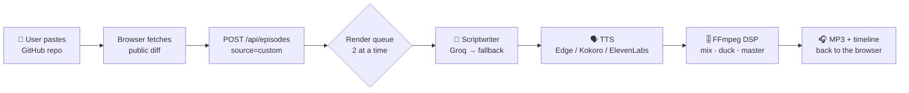
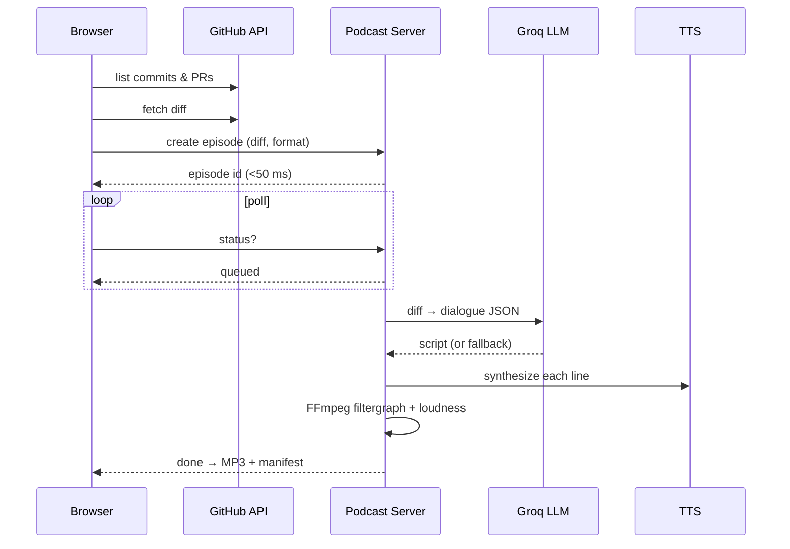
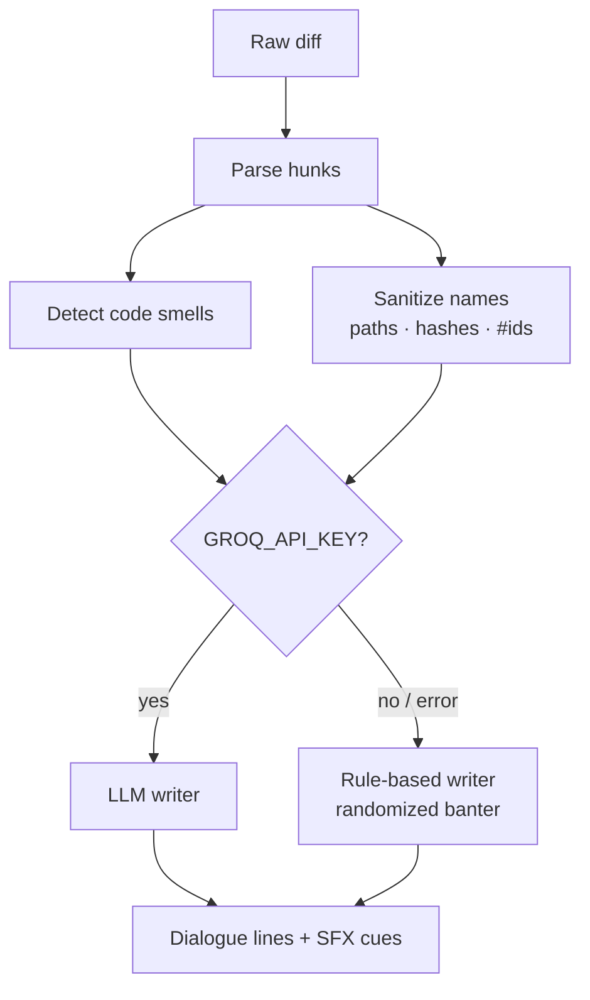
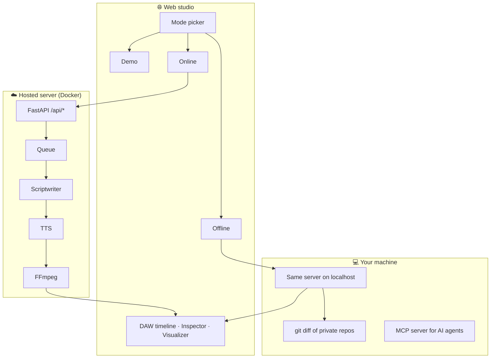
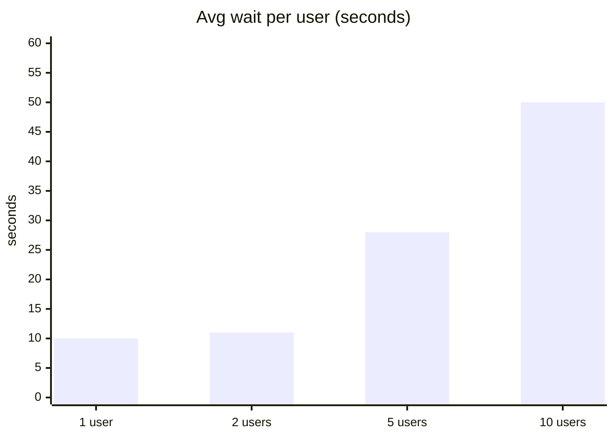
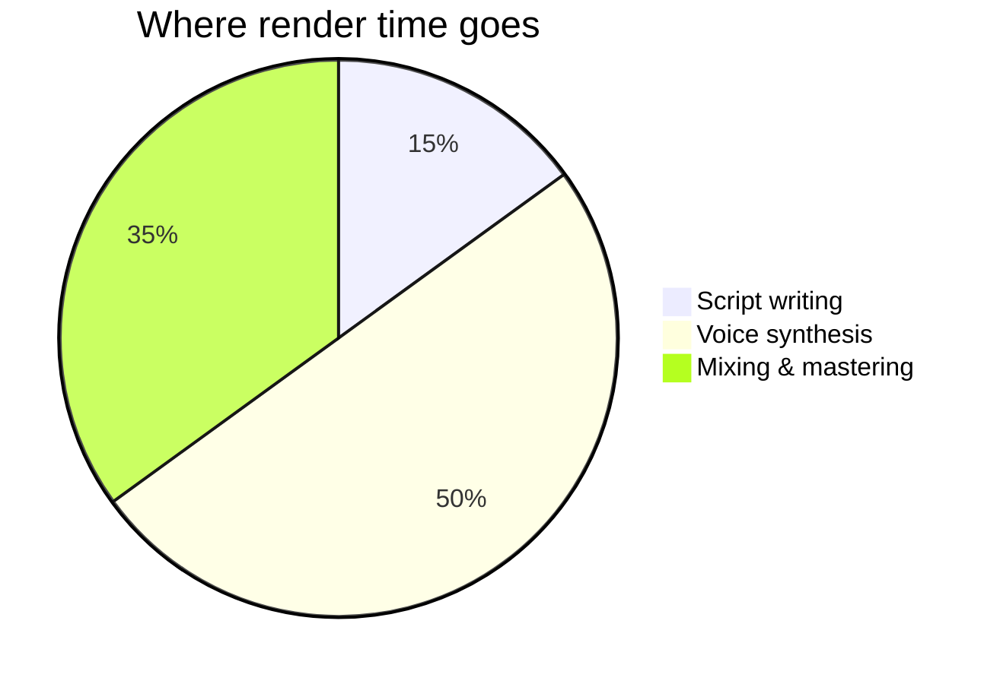

<div align="center">

# 🎙️ Code To AI Podcast

**Turn any GitHub commit or pull request into a broadcast-quality, two-host AI podcast.**

[](https://mcp.daniyal.online)


*PR roasts · code explainers · incident postmortems — mixed, mastered, and ready to play.*

</div>

---

## ✨ What it does

Paste a public GitHub repo, pick a commit or PR, choose a format, and hit **Generate**. Seconds later you get a mastered MP3 with two hosts quoting your *actual* code changes, a DAW-style timeline, and a live view of the MCP JSON-RPC calls that built it.

| | Feature | Details |
|---|---|---|
| 🎭 | **3 show formats** | 2-Host PR Roast · Code Explainer · Incident Postmortem |
| 🧠 | **Smart scriptwriter** | Groq `gpt-oss-120b` with a rule-based fallback that never fails |
| 🔍 | **Real code analysis** | Spots debug prints, swallowed errors, TODOs, skipped tests, risky locks/auth/SQL |
| 🗣️ | **Natural speech** | No commit hashes or full paths read aloud — clean, human phrasing |
| 🎚️ | **Broadcast DSP** | Ducking, panning, SFX cues, EBU R128 loudness normalisation |
| 🌐 | **Three modes** | Interactive demo · Online (zero install) · Offline (private code, local) |
| 🚦 | **Fair queue** | Concurrent users wait in line with live position updates |

---

## 🧭 How it works



### Episode lifecycle



### Script pipeline



---

## 🏗️ Architecture



Only the active mode talks to its server — online never touches localhost, offline never contacts the cloud.

---

## 📊 Performance

On a 2-core ARM server with 12 GB RAM:





*Approximate figures; voice synthesis runs in the cloud, so CPU is mostly spent on mixing.*

---

## 🚀 Quick start

### Online — zero install
Open **[mcp.daniyal.online](https://mcp.daniyal.online)**, choose **Online**, paste a public repo like `sindresorhus/slugify`, and generate.

### Self-host the server
```bash
git clone https://github.com/daniyallko/code-to-ai-podcast.git
cd code-to-ai-podcast
docker build -t podcast-api ./mcp-server
docker run -d --name podcast-api --restart unless-stopped -p 8000:8000 \
  -e TTS_PROVIDER=edge -e GROQ_API_KEY=your_key podcast-api
curl -s http://localhost:8000/api/status
```

### Offline — private code
Choose **Offline** on the site and copy the setup prompt into your AI coding agent. It checks what's already installed and only adds what's missing — re-pasting it just reconnects.

### Run the web studio locally
```bash
bun install
bun run dev
```

---

## ⚙️ Configuration

| Variable | Default | Purpose |
|---|---|---|
| `TTS_PROVIDER` | `edge` | `edge`, `kokoro`, or `elevenlabs` |
| `GROQ_API_KEY` | — | Enables the LLM scriptwriter |
| `GROQ_MODEL` | `openai/gpt-oss-120b` | Override the Groq model |
| `HOST` / `--host` | `127.0.0.1` | Bind address (Docker uses `0.0.0.0`) |

---

## 🗂️ Project layout

```
├── src/                 # Web studio (React + TanStack Start)
│   ├── components/      # DAW, inspector, mode panels
│   └── lib/             # GitHub client, server hooks, demo scenario
├── mcp-server/
│   ├── src/             # FastAPI + MCP server, scriptwriter, TTS, DSP
│   ├── tests/           # pytest suite
│   └── Dockerfile
└── docker-compose.yml
```

---

## 🧪 Tests

```bash
cd mcp-server && pip install -e . && pytest     # server
bunx vitest run                                  # web
```

---

<div align="center">

Made with ☕ by **[Mohd Daniyal](https://github.com/daniyallko)** · If this made you laugh at your own PR, drop a ⭐

</div>
